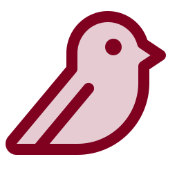
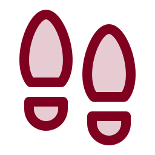
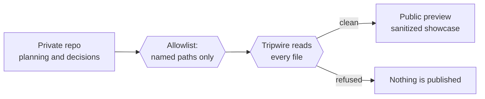
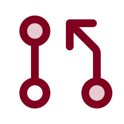

<!-- readme-standard: 2026-11-02 -->

# Littlebird Ambassador 🐦

*Context engine for the agent fleet: always-on observation, one morning brief at a time.*

 **You are here:** drasticstatic lab › source `littlebird-ambassador` (private) → twin `littlebird-ambassador-public-preview` (public) · `main` is the working branch

##  TL;DR

1.  **What this is.** How Littlebird's always-on context layer feeds into Christopher Wilson's agent fleet, and is eventually fed by it: the planning here, a sanitized showcase on the public preview.
2.  **Who it is for.** Anyone curious what a context layer does for a whole fleet of agents, not just one assistant.
3.  **Do this first.** [Explore the public preview](https://drasticstatic.github.io/littlebird-ambassador-public-preview/).

---

 **[Explore the Public Preview →](https://drasticstatic.github.io/littlebird-ambassador-public-preview/)**

---

>  **Public mirror notice:** This repository is partially mirrored to a public preview via an automated GitHub Actions pipeline. The public version includes only sanitized, generalized content. Private planning notes, program specifics, and personal context are excluded.

---

##  Table of Contents

- [What This Is](#what-this-is)
- [The Goal](#the-goal)
- [Capabilities](#capabilities)
- [Architecture](#architecture)
- [Collaboration](#collaboration)
- [Suggest a change](#suggest-a-change)
- [License](#license)

---

##  What This Is

Littlebird is a context engine that runs continuously in the background, building a picture of how Christopher Wilson works — across an AI agent fleet spanning Claude Code CLI and Augment Intent, not just a single tool. This repo tracks that integration: how Littlebird's context layer feeds into, and is eventually fed by, the rest of the ecosystem.

**Developer / builder:** Christopher Wilson (`drasticstatic`)
**AI agents:** Alfred (Claude Code CLI) — public-preview lane & showcase content

---

##  The Goal

Turn always-on context capture into something the agent fleet can actually use — daily briefings that carry forward into agent sessions, and eventually a two-way feed where the fleet's own work informs what Littlebird understands. The public-preview lane exists to show how this fits together, without exposing the private context data behind it.

- **Daily context handoff** — a standing morning routine summarizes what matters and hands it to whichever agent picks up the day's work
- **Full-screen observation** — Littlebird watches both Claude Code CLI and Augment Intent sessions, not just one tool in isolation
- **Cross-agent showcase** — demonstrating how a context layer like this strengthens an entire agent fleet, not just a single assistant

---

##  Capabilities

###  Core

- Continuous, consented screen observation across the agent fleet's working environment
- A daily briefing routine, tuned over time as calibration improves
- Cross-referencing agent-fleet documentation to keep Littlebird's own understanding current

###  Technical

- Public-preview lane synced via the same GitHub Actions pipeline used across this ecosystem
- Cross-references into `trading-assistant` (Fortuna's domain) and `mystarch_chief-of-staff` (Augment Intent's coordination seat) as showcase content develops

---

##  Architecture

- **Private repo (this one):** planning notes, calibration status, and integration decisions
- **Public preview:** sanitized showcase content — no personal calendar, program, or account details
- **Sync:** GitHub Actions, allowlist model — everything private by default, only explicitly-classified paths reach the public mirror

---

##  Collaboration

This is a solo-developer project (Christopher Wilson) built with AI-agent assistance. Issues and discussion on the public preview are welcome; the private planning content in this repo stays private.

---

##  Suggest a change

Noticed something? Open an [issue](../../issues) or a pull request against `main`; Christopher reads them and a person with the role merges. Not on GitHub? Reach him through any channel on [his profile](https://github.com/drasticstatic). On the public preview, please open an issue rather than a pull request: its files are synced from the private source, so a change made only there would be overwritten.

---

##  License

[MIT](LICENSE) — applies to this repo's own content (docs, configuration, showcase code). It does not extend to Littlebird's own product, brand, or any third-party service referenced here.

---

*Built and maintained by [drasticstatic](https://github.com/drasticstatic) · w/ Anthropic's Claude Code CLI*

The front door follows the living [README standard](https://github.com/drasticstatic/my-template/blob/main/README-STANDARD.md). Copy it, improve it. Icons: Phosphor duotone (MIT).
